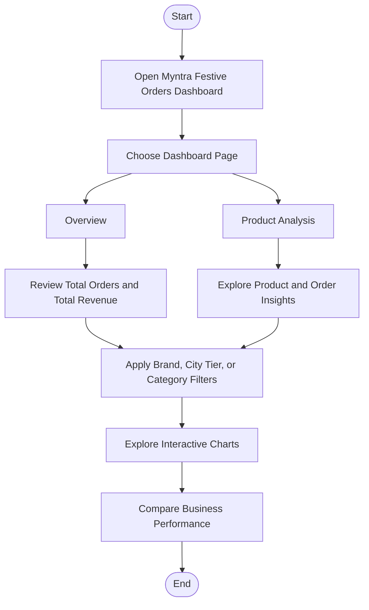
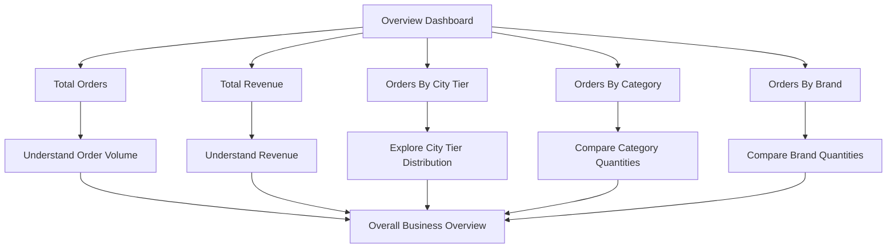
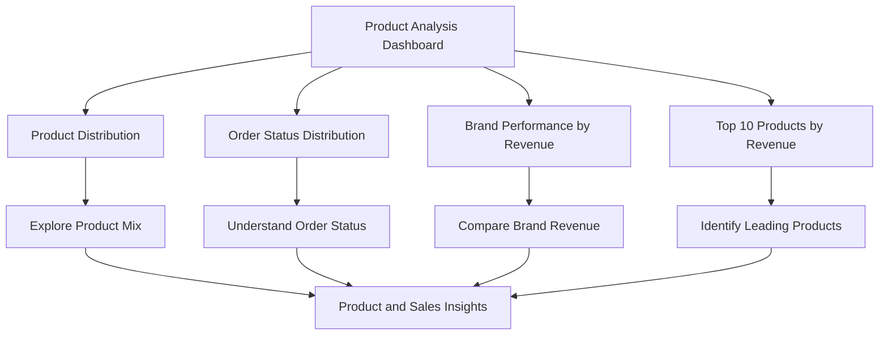
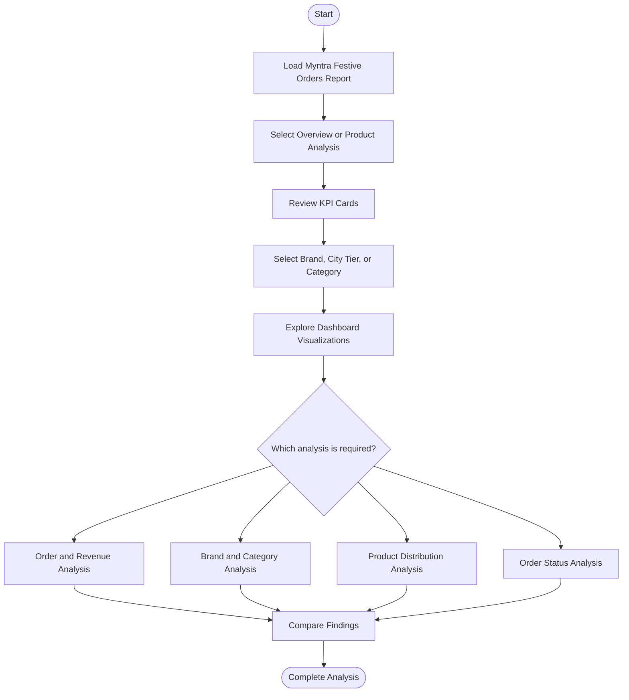

# Myntra Festive Orders Analysis Dashboard

An interactive Power BI dashboard designed to explore Myntra festive order activity, revenue, brand performance, product distribution, order status, and customer market segments.

## Project Overview

The **Myntra Festive Orders Analysis Dashboard** presents key business information through interactive KPI cards, charts, and slicers. It helps users explore order volume and revenue, compare brand and category performance, understand product distribution, and review order status across city tiers.

The Power BI report is organized into two pages:

1. **Overview**
2. **Product Analysis**

## Dashboard at a Glance

| Dashboard Page | Main Focus | Key Analysis |
|---|---|---|
| Overview | Business summary | Total orders, total revenue, city-tier distribution, category quantity, and brand quantity |
| Product Analysis | Product and brand performance | Product distribution, order status, brand revenue, and top 10 products by revenue |

## Dashboard Navigation Flowchart



## Page 1: Overview

The Overview page provides a summary of order activity and revenue, along with category, brand, and city-tier analysis.

### Key Performance Indicators

| KPI | Calculation / Field | Business Purpose |
|---|---|---|
| Total Orders | Count of `Order_ID` | Shows the number of order records |
| Total Revenue | Sum of `Net_Revenue` | Shows the total revenue generated |

### Visualizations

| Visualization Title | Chart Type | Data Fields | Purpose |
|---|---|---|---|
| Orders By City Tier | Donut chart | `City_Tier`, Order ID count | Shows how orders are distributed across city tiers |
| Orders By Category | Clustered column chart | `Category`, Sum of `Quantity` | Compares quantity across product categories |
| Orders By Brand | Clustered bar chart | `Brand_Name`, Sum of `Quantity` | Compares quantity across brands |

### Interactive Filters

| Slicer | Field | Usage |
|---|---|---|
| Brand | `Brand_Name` | Explore selected brands |
| City Tier | `City_Tier` | Focus on a city tier |
| Category | `Category` | Explore selected product categories |

### Overview Analysis Flow



## Page 2: Product Analysis

The Product Analysis page focuses on product distribution, order status, brand revenue, and the top 10 products by revenue.

### Key Performance Indicators

| KPI | Calculation / Field | Business Purpose |
|---|---|---|
| Total Orders | Count of `Order_ID` | Tracks order volume |
| Total Revenue | Sum of `Net_Revenue` | Tracks revenue generated |

### Visualizations

| Visualization Title | Chart Type | Data Fields | Purpose |
|---|---|---|---|
| Product Distribution | Donut chart | `Product_Name`, SKU count | Displays product distribution based on SKU records |
| Order Status Distribution | Donut chart | `Order_Status`, Order ID count | Shows the distribution of orders by status |
| Brand Performance (Revenue) | Clustered bar chart | `Brand_Name`, Sum of `Net_Revenue` | Compares revenue across brands |
| Top 10 Products By Revenue | Table | Brand, Product, Category, Order ID, Net Revenue | Presents the top 10 products by revenue |

### Interactive Filters

| Slicer | Field | Usage |
|---|---|---|
| Brand | `Brand_Name` | View selected brand information |
| City Tier | `City_Tier` | Explore performance by city tier |
| Category | `Category` | Focus on selected product categories |

### Product Analysis Flow



## Data Model and Main Fields

The report uses the following model tables:

- `myntra_festive_orders`
- `myntra_orders_master`

### Main Fields Used

| Field | Description | Dashboard Usage |
|---|---|---|
| `Order_ID` | Order identifier | Total orders and order status distribution |
| `Net_Revenue` | Net revenue value | Total revenue and brand revenue |
| `Brand_Name` | Brand name | Brand filters and brand comparisons |
| `City_Tier` | City tier classification | City-tier filter and order distribution |
| `Category` | Product category | Category filter and quantity comparison |
| `Quantity` | Product quantity | Category and brand quantity analysis |
| `Product_Name` | Product name | Product distribution and top products |
| `SKU` | Stock Keeping Unit | Product distribution |
| `Order_Status` | Order status | Order status distribution |

## Complete Dashboard Analysis Workflow



## Visualization Guide

| Visual | Best Use | Dashboard Application |
|---|---|---|
| KPI Card | Displaying important business metrics | Total Orders and Total Revenue |
| Donut Chart | Showing category proportions or distributions | City Tier, Product, and Order Status |
| Clustered Column Chart | Comparing values across categories | Orders By Category |
| Clustered Bar Chart | Comparing multiple categories horizontally | Orders By Brand and Brand Revenue |
| Table | Displaying detailed records in rows and columns | Top 10 Products By Revenue |
| Slicer | Interactive report filtering | Brand, City Tier, and Category |

## Business Questions Explored

The dashboard helps users investigate questions such as:

1. How many orders are represented in the report?
2. What is the total revenue generated?
3. How are orders distributed across city tiers?
4. Which categories have higher order quantities?
5. How do brands compare by quantity?
6. How are products distributed?
7. What is the distribution of orders by status?
8. Which brands generate higher revenue?
9. Which are the top 10 products by revenue?
10. How do brand, city tier, and category selections affect the dashboard insights?

## How to Use the Dashboard

1. Open the `pr_2.pbix` file in Microsoft Power BI Desktop.
2. Select the **Overview** page to explore order and revenue summaries.
3. Select the **Product Analysis** page to explore product and brand performance.
4. Use the Brand, City Tier, and Category slicers to filter the report.
5. Explore the charts and tables to compare the selected business segments.
6. Review the KPI cards to understand the metrics under the current filter selection.
7. Change the slicers to explore different combinations of brands, city tiers, and categories.

## Project Structure

```text
Myntra-Festive-Orders-Analysis/
│
├── pr_2.pbix
└── README.md
```

## Tools and Technologies

| Tool / Technology | Purpose |
|---|---|
| Microsoft Power BI Desktop | Dashboard development and reporting |
| Power BI Visualizations | KPI cards, donut charts, bar charts, column charts, and tables |
| Power BI Slicers | Interactive filtering |
| Mermaid | Flowchart and workflow diagrams |
| Markdown | Project documentation |

## Project Summary

The **Myntra Festive Orders Analysis Dashboard** brings together order, revenue, brand, category, city-tier, product, and order-status insights in one interactive Power BI report.

With its two dedicated report pages, clear KPI cards, interactive filters, and varied visualizations, the dashboard provides an accessible way to explore festive order performance and product-level business information.

---

**Project Name:** Myntra Festive Orders Analysis Dashboard  
**Report File:** `pr_2.pbix`  
**Documentation File:** `README.md`

## Project Video

[Watch the dashboard video](https://drive.google.com/file/d/1uuari0y5nPNCKwztgzANFeEG6RWyHGX8/view?usp=sharing)
